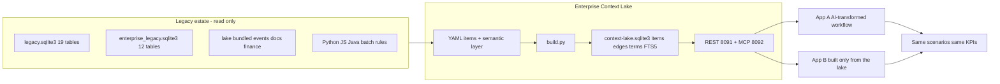
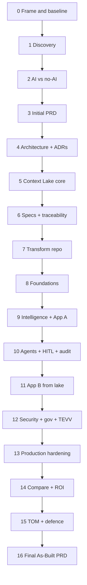

# Execution Plan — Sprint 4 Fabpulse Capstone

| Field | Value |
|---|---|
| Stage | Method layer. Written after `Project_Intent.md`, before any repo change. |
| Date / version | 2026-10-18, v2.2 |
| Author | Mangesh (FDE), drafted with Cursor |
| Status | ACTIVE |
| Evidence sources | `AI_FDE_Capstone_—Final_Presentation_Guidelines.pdf` (28 guidelines); `Project_Intent.md`; `00-Best Practices/AI_FDE_End-to-End_Production_Delivery_Spine.pdf` (46 units: 0A, 0B, 0C, stages 1 to 42, and FINAL); `00-Best Practices/Semantic_Layer_capture.pdf`, `Prompt_Anatomy.pdf`, `Prompt Template.pdf`; `01-Learnings from previous Sprints/Implementation Best Practices for FDEs.md`; the Sprint 3 hardening practices in `SPRINT3CAPSTONE` (S03 review loop, S04 two-half gates, S05-14 audit chain); the inherited repo `fabpulse-legacy-workshop-v8-Semiconductor/fabpulse-legacy` |
| Assumptions | The inherited repo is the only system under change. All data is local and synthetic. Azure OpenAI is primary; a recorded-replay mode lets the demo run offline on this laptop. Application B is a full fab-exception app driven only by the Context Lake; the trainer confirmed this reading on 2026-10-17. |
| Unresolved issues | Birlasoft brand assets are not yet in hand. They will be obtained before Phase 15; a neutral placeholder deck is used until then. The operational meaning of "closed" is now set by the designated FDE SME (a case is closed only when a final disposition is recorded and no engineering action is pending). The remaining open point is narrow: whether operationally closed also means finance-booked and audit-closed. That carries company liability and still needs a Business Owner sign-off; until then those cases route to review. See `Decision_Tracker.md`. |
| Residual risks | Time. Phases 5, 9, 10, and 11 hold the most work. The order puts the Context Lake and the evidence first, so a partial result still shows the core idea. |

## 1. What this file is

This file is the ordered work method for the Sprint 4 capstone. `Project_Intent.md` is the locked brief. This file turns that brief into phases.

Each phase states nine things: an action, a scope with an exclude list, analysis dimensions, evidence rules, output files, a completion gate, the guidelines it satisfies, the spine units it covers, and a lifecycle link. Those parts come from `Prompt_Anatomy.pdf`.

Each phase holds one or more spine sub-stages. A sub-stage is one spine unit. It writes to its own `docs/NN-*/` folder and has its own sub-gate. The phase gate passes only when every sub-gate passes. Section 7 lists the full map from spine unit to phase to folder.

How the three agents run is drawn in `playbook/EXECUTION_ARCHITECTURE.md`. Each phase is run from one prompt in the `playbook/` folder. Three agents run the work. A coordinator (Grok 4.7) settles the decisions and orchestrates; it spawns a fresh executor (Grok 4.6) that reads the inputs and writes the output; it then spawns a separate reviewer (Composer 2.5) that checks the output against the Expected output and runs the Done test before the next phase starts. The executor and the reviewer are fresh agents on their own models, so no agent grades its own work and the builder is not the checker. Each phase prompt carries four sections: Inputs, a fenced Prompt with Locked facts, Expected output, and a Done test. There is no single giant prompt.

## 2. What this plan delivers

The plan delivers against six sources.

- The 28 guidelines in `AI_FDE_Capstone_—Final_Presentation_Guidelines.pdf`. This covers the engineering set, guidelines 1 to 18, and the presentation set, guidelines 19 to 28.
- The spine in `AI_FDE_End-to-End_Production_Delivery_Spine.pdf`. It has 46 units: three pre-flight units (0A, 0B, 0C), stages 1 to 42, and a FINAL as-built unit. The order and depth adapt to the semiconductor use case. Guideline 1 allows this and calls the spine "indicative yet prescriptive". This plan maps every one of the 46 units to a phase sub-stage, so none is dropped.
- The Sprint 3 hardening practices. Three are reused here: the per-control two-half gate (a design half, then a small change half with before-and-after evidence); the Context Lake review, fix, and revision loop with a version bump; and a named audit chain keyed by a correlation id.
- The future-state intent in `Project_Intent.md`.
- The semantic-layer format in `Semantic_Layer_capture.pdf`. Markdown explains, YAML defines, JSON Schema validates, tests protect, and generated output serves.
- The prompt discipline in `Prompt_Anatomy.pdf` and `Prompt Template.pdf`.
- The reuse and portability lessons in `Implementation Best Practices for FDEs.md`.

## 3. The business problems this plan must solve

Every demo scenario is tied to a real defect found in the packaged data. These are the problems the judges must see resolved.

| # | Business problem | Evidence in the repo |
|---|---|---|
| BP1 | Recipe revision differs between dispatch and equipment | 91 of 125 process steps have a `recipe_version` that differs from the tool's `recipe_rev` |
| BP2 | Replayed deliveries inflate the exception queue | REPLAY feeds in `partner_feeds`; the 2025 rollback in `docs/historic-decisions.md` |
| BP3 | Event time, arrival time, and effective date are confused | Late and backfilled events; overlapping ranges in `reference_versions` |
| BP4 | The same rule is built four ways, and they disagree | Python uses 50,000; JavaScript uses limit times 1.05 with a 999,999 default; the night batch treats REVIEW as open; Java sums as floats and drops blanks |
| BP5 | "Open" and "closed" differ across sites and systems | Five status word lists; `docs/correspondence/operations-vs-risk-2024.md` |
| BP6 | Three region vocabularies and overlapping policies | APAC/EMEA/AMER versus 8 country codes versus site codes; `policy_register` has 4 to 5 active rows per region |
| BP7 | Untrusted text tries to drive decisions | 150 events, 86 feeds, 3 emails, and 22 source documents carry "approve" or "ignore" instructions |
| BP8 | No API authorization; disputed ownership; manual reconciliation | No auth in `app/server.py`; INC-2025-014 records "follow-up owner unknown" |

## 4. Locked target architecture

Two FastAPI and React applications sit over one shared, read-only Context Lake.

These choices are fixed. Each one gets an ADR.

- Two applications, built differently, measured the same.
- The lake is authored as YAML in Git and built into one SQLite file.
- The knowledge graph is an `edges` table in that SQLite file, not a separate graph server.
- Agents run in LangGraph. The approval pause uses `interrupt()` and `Command(resume=...)`.
- OPA decides whether an action needs a person: EXECUTE, HOLD_FOR_REVIEW, or BLOCK.
- Application A takes its rules from its own transformed code. Application B takes its rules only from the lake. This keeps the comparison honest.
- Every agent step and every human approval writes one row to an audit chain. Each row carries a correlation id, so one case can be traced end to end. This is the Sprint 3 S05-14 practice.
- The Context Lake carries a version. A change to it goes through a review, a fix round, and a revision that raises the version and records an ADR. This is the Sprint 3 S03 review loop.
- Ports: 8080 legacy, 8090 source gateway, 8091 lake REST, 8092 lake MCP.

## 5. Phases

Each phase lists: Action, Scope with an exclude list, Sub-stages (one spine unit each, with its folder and sub-gate), Analysis, Evidence, Outputs, Gate, Guidelines, Spine, and Lifecycle. The phase gate passes only when every sub-gate passes.

### Phase 0 — Frame, govern, and freeze the baseline

- Action: Orient on the estate, set a provisional operating contract and an economics envelope, qualify the engagement, frame the problem, and freeze the baseline KPIs. Build the source register with a SHA-256 hash for every file.
- Scope: The whole repo, read only. Exclude: any code change.
- Sub-stages:
  - 0A Pre-flight orientation. `docs/00-preflight/discovery/`: `repository-overview.md`, `system-landscape.md`, `technology-inventory.md`, `high-level-architecture.md`, `assumptions-unknowns.md`, `initial-risk-register.md`. Sub-gate: orientation is enough to qualify, with no transformation recommendations yet.
  - 0B Provisional operating contract. `docs/00-preflight/operating-contract/`: `provisional-operating-contract.md`, `scope-boundaries.md`, `repository-write-boundaries.md`, `provisional-human-approval-rules.md`, `stop-conditions.md`, `open-governance-decisions.md`. Sub-gate: boundaries and decision rights recorded as PROVISIONAL; unresolved owners flagged, not invented.
  - 0C AI-economics envelope. `docs/00-preflight/ai-economics/`: `workload-assumptions.md`, `solution-scenarios.md`, `provisional-token-budget.md`, `quality-latency-cost-envelope.md`, `preliminary-finops-baseline.md`. Sub-gate: a provisional cost, token, and latency envelope exists; Phase 2 and Phase 13 reconcile against it.
  - 1 Engage and qualify. `docs/01-engagement/`: `engagement-canvas.md`, `team-charter.md`, `qualification-checklist.md`, `engagement-go-no-go.md`. Sub-gate: a Go, Conditional Go, or No-Go with evidence.
  - 2 Stakeholders. `docs/02-stakeholders/`: `stakeholder-map.md`, `decision-rights-map.md`, `approval-authority-map.md`, `operating-contract-confirmations.md`. Sub-gate: decision rights reconciled with 0B; unresolved owners recorded as gaps.
  - 3 Problem and value. `docs/03-problem-value/`: `problem-statement.md`, `personas.md`, `jobs-to-be-done.md`, `scope-exclusions.md`, `nfrs.md`, `success-criteria.md`. Sub-gate: a technology-neutral problem definition.
  - 4 Baseline KPIs. `docs/04-baseline-kpis/`: `kpi-dictionary.md`, `baseline-kpi-sheet.md`, `measurement-methodology.md`, `kpi-baseline-signoff.md`. Sub-gate: the baseline reproduces twice with identical numbers; definitions frozen.
- Analysis: Stakeholders, current KPIs, incident history, decision rights.
- Evidence: `verify_preloaded.py`, `workshop_check`, and `app.baseline` output, run twice.
- Outputs: the seven folders above, plus `sources/register.yaml`.
- Gate: every sub-gate passes; the baseline reproduces twice.
- Guidelines: 1, 18, 23. Spine: 0A, 0B, 0C, 1, 2, 3, 4.
- Lifecycle: Feeds every later phase. The register and the frozen KPIs are inputs to Phase 5 and Phase 14.

### Phase 1 — Discovery and deep brownfield

- Action: Map the current process, find the root causes, and assess the repo in depth. Build the conflict catalogue BP1 to BP8, one query per conflict.
- Scope: Code, data, docs, contracts. Exclude: any change.
- Sub-stages:
  - 5 Current process and landscape. `docs/05-current-state/`: `current-process-map.md`, `system-landscape.md`, `integration-landscape.md`, `brownfield-inventory.md`, `process-bottlenecks.md`, `conflict-catalogue.md` (BP1 to BP8, each with a query and result). Sub-gate: the end-to-end process is mapped and every conflict has a reproducible query.
  - 6 Root cause. `docs/06-root-cause/`: `root-cause-tree.md`, `five-whys.md`, `evidence-confidence-matrix.md`, `confirmed-root-causes.md`. Sub-gate: each cause carries supporting evidence and a confidence.
  - 7 Deep repo assessment. `docs/07-repo-assessment/`: `repo-assessment.md`, `dependency-map.md`, `technical-debt-register.md`, `critical-workflow-inventory.md`, `baseline-behaviour.md`, `characterization-test-plan.md`. Sub-gate: critical workflows named; a characterization plan exists where coverage is thin.
- Analysis: Data relationships, temporal fields, trust labels, duplication.
- Evidence: One cited query per conflict; baseline test results.
- Outputs: the three folders above.
- Gate: every sub-gate passes; every conflict has a reproducible query.
- Guidelines: 27. Spine: 5, 6, 7.
- Lifecycle: The conflict catalogue becomes lake items in Phase 5.

### Phase 2 — AI-versus-no-AI qualification

- Action: Decide, per capability, whether to use GenAI, deterministic code, or neither. Run the machine-learning test: try to predict `engineering_hold` from the lot fields and show it does no better than guessing the most common answer. Reconcile the result with the 0C envelope.
- Scope: Each candidate capability. Exclude: building any model.
- Sub-stages:
  - 8 AI-versus-no-AI. `docs/08-ai-qualification/`: `intervention-options.md`, `ai-vs-no-ai-matrix.md`, `deterministic-vs-ai-boundaries.md`, `minimum-intelligence-assessment.md`, `minimum-agency-assessment.md`, `economics-baseline-reconciliation.md`, `qualification-decision.md`. Sub-gate: each capability is labelled GenAI, deterministic, or ML-rejected with a reason; the ML null-test result is recorded; the 0C envelope is reconciled and irrelevant AI cost assumptions are retired.
- Analysis: Business risk, data variety, repeatability.
- Evidence: The ML test result; the text-variety counts.
- Outputs: the folder above.
- Gate: the sub-gate passes.
- Guidelines: 24. Spine: 8.
- Lifecycle: Sets what Phases 9 to 11 may use AI for.

### Phase 3 — Initial PRD and product intent

- Action: Write the initial PRD. Name users, workflows, AI limits, scope, exclusions, and the demo flow.
- Scope: Both apps. Exclude: implementation detail.
- Sub-stages:
  - 9 Initial PRD. `docs/09-initial-prd/`: `initial-prd.md`, `capability-map.md`, `functional-requirements.md`, `nfrs.md`, `mvp-scope.md`, `non-goals.md`, `initial-prd-traceability.md`. Sub-gate: the PRD names both apps and the demo flow; every feature traces to a business problem; BO-04 is signed or deferred.
- Analysis: Stakeholder outcomes, acceptance criteria.
- Evidence: Cites Phases 1 and 2.
- Outputs: the folder above.
- Gate: the sub-gate passes.
- Guidelines: 4, 16, 21. Spine: 9.

### Phase 4 — Target architecture and ADRs

- Action: Write the target architecture and the ADRs for every fixed choice in section 4, including the audit chain and the Context Lake review loop.
- Scope: Architecture only. Exclude: code.
- Sub-stages:
  - 10 Target architecture and ADRs. `docs/10-architecture/`: `architecture-options.md`, `target-architecture.md`, `component-model.md`, `security-architecture.md`, `architecture-decision-summary.md`. `docs/10-architecture/adrs/`: one ADR per fixed choice, including `adr-audit-chain.md` and `adr-context-lake-review-loop.md`. Sub-gate: every fixed choice has an ADR that lists its rejected options.
- Analysis: Alternatives, risks, cost, portability.
- Evidence: Each ADR records the rejected options.
- Outputs: the two folders above.
- Gate: the sub-gate passes.
- Guidelines: 1, 11. Spine: 10.

### Phase 5 — Context Lake, semantic layer, and knowledge graph (the core)

- Action: Build the lake. Write the item schema, the harvest scripts, and `build.py` that writes `context-lake.sqlite3`. Enforce the five contract gates. Write rule cards with test cases. Add cross-system mappings. Build the `edges` graph. Write about 25 golden questions and the injection corpus. Run the review, fix, and revision loop and set the lake version.
- Scope: Knowledge about the estate. Exclude: copying raw data rows into the lake.
- Sub-stages:
  - 11 Data, knowledge, and context strategy. `docs/11-data-context/`: `data-source-inventory.md`, `data-contracts.md`, `knowledge-model.md`, `retrieval-strategy.md`, `provenance-policy.md`, `synthetic-data-strategy.md`. The built lake lives in `context-lake/` with `items/`, `semantic-layer/`, `schemas/`, `harvest/`, `build.py`, `generated/context-lake.sqlite3`, `eval/golden-questions.yaml`, and `tests/`. Sub-gate: the build passes; the five contract gates are enforced; golden questions and injection tests pass; all seven content kinds are covered.
  - 11R Review, fix, and revision loop (Sprint 3 S03 practice). A review gate checks the lake items, the rule cards, and the mappings. A fix round applies the numbered fixes. A revision raises the lake version and records an ADR. An "open question for the lake" channel collects terms that later phases find missing. `context-lake/review/`: `lake-review.md`, `lake-fixes.md`, `lake-version.md`. Sub-gate: the review passes or its fixes are applied and the version is set; later phases feed open questions back here.
- Analysis: Coverage of all seven guideline-3 content kinds; graph questions; trust labels.
- Evidence: Schema and tests pass; golden questions and injection tests pass; the review round is recorded.
- Outputs: `docs/11-data-context/`, `context-lake/`, and `context-lake/review/`.
- Gate: every sub-gate passes; the lake carries a version.
- Half A / Half B: Half A is the schema, harvest, mapping, and rule-authority design; Half B is `build.py`, the contract gates, and the tests. The reviewer accepts Half A before Half B starts. The 11R review loop still runs on the built lake.
- Guidelines: 3, 7, 8. Spine: 11.
- Lifecycle: Feeds Phases 6, 9, 10, 11, and 14. A missing term from any later phase returns here through the open-question channel and raises the version.

Rule-authority policy for Phase 5. The canonical value of a business rule comes from the governed, effective-dated source of record: `contracts/decision-policies-archive.json` and the `policy_register` table. In a fab these are the change-control system of record under SEMI-style process traceability. The four legacy variants are recorded as deviations with parity tests: the Python 50,000 cutoff, the JavaScript limit-times-1.05 tolerance and 999,999 default, the Java float totals that drop blank rows, and the night batch that treats REVIEW as open. Where the governed source is silent, overlapping, or self-contradictory, the canonical rule routes the case to HOLD_FOR_REVIEW; it does not guess. This covers a no-match policy lookup and overlapping active intervals. For "open" and "closed", disputed in `docs/correspondence/operations-vs-risk-2024.md`, the designated FDE SME sets the operational meaning: a case is open while any disposition or engineering action is pending, including REVIEW and HOLD, and closed only when a final disposition is recorded and no engineering action is pending. Whether operational closure also means finance-booked and audit-closed is a Business Owner call (BO-06b); until it is made, the three meanings stay separate in the semantic layer and a case that is operationally closed but not finance or audit closed routes to review. No new threshold is invented. A value absent from the governed source stays PROPOSED with a named owner. Each rule card carries `authority: policy_archive`, `authority: sme`, or `authority: unresolved`.

### Phase 6 — Spec-driven design and contracts

- Action: Write scenarios, non-functional requirements, API and event contracts, and acceptance criteria. Build the traceability from requirement to spec to test to evidence. Cite lake item ids.
- Scope: Specs. Exclude: code.
- Sub-stages:
  - 12 Spec-driven design. `docs/12-specs/`: `system-spec.md`, `api-contracts.md`, `event-contracts.md`, `schema-specifications.md`, `business-rules.md`, `error-handling-spec.md`, `acceptance-criteria.md`. Sub-gate: every spec traces to a lake item; no material ambiguity is left to implementation.
  - 13 Traceability. `docs/13-traceability/`: `requirements-traceability-matrix.md`, `spec-to-test-map.md`, `test-to-evidence-map.md`, `coverage-gap-register.md`. Sub-gate: requirement to spec to test to evidence is mapped; no critical orphan requirement.
- Analysis: Error semantics, role permissions, SLOs.
- Evidence: Each spec traces to a lake item.
- Outputs: the two folders above.
- Gate: every sub-gate passes.
- Guidelines: 9, 18. Spine: 12, 13.

### Phase 7 — Transform the repo

- Action: Plan the transformation, then strangle the high-value workflows behind characterization tests, then validate the transformed repo against the baseline.
- Scope: The legacy app. Exclude: changing behaviour before a test locks it.
- Sub-stages:
  - 14 Transformation plan. `docs/14-transformation/`: `transformation-backlog.md`, `migration-roadmap.md`, `cutover-plan.md`, `rollback-strategy.md`, `transformation-gates.md`. Sub-gate: the increments, the cutover, and the rollback are defined; components that stay unchanged are named.
  - 15 Transform. `docs/15-modernization/`: `transformation-log.md`, `changed-components.md`, `behavior-preservation-evidence.md`, `approved-behavior-changes.md`, `test-execution-log.md`. Plus `tests/characterization/` and the transformed services. Sub-gate: each change is preceded by a characterization test; behaviour is preserved except where an approved spec changes it.
  - 16 Validate. `docs/16-repo-validation/`: `repo-quality-gate.md`, `regression-results.md`, `behavior-difference-report.md`, `validation-signoff.md`. Sub-gate: characterization parity holds; every behaviour difference against the Phase 7 baseline is explained.
- Analysis: Parity against the baseline.
- Evidence: Characterization tests, shadow runs.
- Outputs: the three folders above, plus `tests/characterization/`.
- Gate: every sub-gate passes; characterization parity holds.
- Guidelines: 10, 27. Spine: 14, 15, 16.

### Phase 8 — Implementation PRD and delivery foundations

- Action: Finalise the implementation PRD, plan the delivery increments, and stand up identity, CI/CD, observability, and the data seams.
- Scope: Platform. Exclude: app features.
- Sub-stages:
  - 17 Implementation PRD. `docs/17-implementation-prd/`: `implementation-prd.md`, `prd-change-log.md`, `finalized-nfrs.md`, `release-boundaries.md`, `implementation-baseline-signoff.md`. Sub-gate: the Initial PRD is reconciled with repo findings; every invalidated assumption is recorded.
  - 18 Delivery planning and foundations. `docs/18-delivery/`: `delivery-backlog.md`, `definition-of-done.md`, `acceptance-test-plan.md`, `evaluation-rubric.md`, `evidence-checklist.md`. Plus the CI config and the compose files. Sub-gate: the platform deploys from one command and emits telemetry; the Definition of Done is set.
- Analysis: Deployability, telemetry.
- Evidence: A deployable platform baseline.
- Outputs: the two folders above, plus CI and compose files.
- Gate: every sub-gate passes; the platform deploys.
- Guidelines: 5, 13. Spine: 17, 18.

### Phase 9 — Intelligence core and Application A

- Action: Build the intelligence core and App A. Add version-controlled prompts, a model configuration, a retrieval pipeline and its evaluation, grounded triage, conflict explanation with citations, a role-based UI, and exception handling.
- Scope: App A. Exclude: App B.
- Sub-stages:
  - 19 Intelligence core. `docs/19-intelligence/`: `prompt-registry.md`, `model-configuration.md`, `retrieval-pipeline.md`, `rag-design.md`, `evaluation-dataset-spec.md`, `rag-evaluation-results.md`, `grounding-results.md`, `intelligence-release-gate.md`. The executable prompts and config are also version-controlled in the app. Sub-gate: the evaluation datasets are built before tuning; groundedness, citation, and abstention are measured; prompts are versioned.
  - 20 Application and services. `docs/20-application/`: `application-component-map.md`, `deterministic-ai-boundary.md`, `access-control-implementation.md`, `application-readiness.md`. Plus `apps/app_a/`. Sub-gate: scenarios 7 to 11 run; every AI answer cites a lake item or abstains; deterministic logic is separate from the model.
- Analysis: Groundedness, UX, error states.
- Evidence: Scenarios 7 to 11 run in App A.
- Outputs: the two folders above, plus `apps/app_a/`.
- Gate: every sub-gate passes; scenarios 7 to 11 run.
- Guidelines: 5, 6. Spine: 19, 20.

### Phase 10 — Integration, agentic engineering, and human approval

- Action: Integrate the systems of record, build the LangGraph agents with read-only tools and OPA gates, add the approval queue and SQLite checkpoints, and write the audit chain keyed by a correlation id.
- Scope: Agents, gates, integration, audit. Exclude: write tools for the model.
- Sub-stages:
  - 21 Enterprise integration. `docs/21-integration/`: `integration-inventory.md`, `adapter-map.md`, `failure-semantics.md`, `reconciliation-rules.md`, `integration-readiness.md`. Sub-gate: schemas, retries, idempotency, and reconciliation are validated.
  - 22 Agentic engineering. `docs/22-agentic-engineering/`: `agent-architecture.md`, `tool-contracts.md`, `tool-permission-map.md`, `graph-definition.md`, `loop-control-policy.md`, `termination-rules.md`, `agent-budget-policy.md`, `agent-test-results.md`. Plus `apps/app_a/agent/`. Sub-gate: the recursion limit holds; no write tool reaches the model; the plan is bounded.
  - 23 Human control and audit chain. `docs/23-human-control/`: `autonomy-matrix.md`, `hitl-workflow.md`, `approval-gates.md`, `human-override-policy.md`, `escalation-matrix.md`, `audit-chain.md`. Plus `policy/opa/` and `apps/app_a/audit/`. The audit chain writes one row per agent step and per human approval, each with a correlation id, and exposes a read by correlation id. Sub-gate: a restart mid-approval keeps state; an injection record yields BLOCK; every agent step and approval writes an audit row that is traceable end to end by correlation id.
- Analysis: Bounded steps, tool allow-list, injection resistance, audit completeness.
- Evidence: A restart mid-approval keeps state; an injection record yields BLOCK; one case traces end to end in the audit chain.
- Outputs: the three folders above, plus `apps/app_a/agent/`, `apps/app_a/audit/`, and `policy/opa/`.
- Gate: every sub-gate passes; restart-safe; injection blocked; audit chain complete.
- Guidelines: 6, 17. Spine: 21, 22, 23.

### Phase 11 — Application B, built only from the lake

- Action: Build App B. It runs the same workflow, takes its rules only from the lake, and adds a context and lineage view. Build the parity harness.
- Scope: App B and the comparison. Exclude: reading the legacy repo at build time.
- Sub-stages:
  - 20p Application B from the lake (stage 20 ported). `apps/app_b/` plus `docs/model-comparison/`: `parity-harness.md`, `app-b-lineage.md`. Sub-gate: App B runs without App A; it uses only lake rules; each A-versus-B difference traces to a lake item; the lineage view shows the correlation id.
- Analysis: Portability, parity, discovery speed.
- Evidence: B runs without A; each difference traces to a lake item.
- Outputs: `apps/app_b/`, `docs/model-comparison/`.
- Gate: the sub-gate passes.
- Guidelines: 3, 4, 14. Spine: 20 ported.

### Phase 12 — Security, governance, TEVV, and red team

- Action: Threat-model the system, map governance obligations, and run TEVV with a red team. Each sub-stage uses the Sprint 3 two-half gate: Half A writes the design, Half B makes the small change and records before-and-after evidence.
- Scope: Security and evaluation. Exclude: new features.
- Sub-stages:
  - 24 Security, privacy, responsible AI. `docs/24-security-privacy/`: `threat-model.md`, `attack-surface-map.md`, `security-control-matrix.md`, `prompt-injection-controls.md`, `agent-security-controls.md`, `security-test-results.md`. Half A: the threat model and the control design. Half B: the control in code plus a test. Sub-gate: Half A passes, then Half B shows the control working.
  - 25 Governance and assurance. `docs/25-governance/`: `compliance-obligations.md`, `compliance-control-matrix.md`, `accountability-map.md`, `ai-system-register.md`, `model-card.md`, `system-card.md`, `governance-readiness.md`. Half A: obligations mapped to controls and owners. Half B: the evidence and the register entries. Sub-gate: Half A passes, then Half B records the evidence.
  - 26 TEVV and red team. `docs/26-tevv/`: `tevv-plan.md`, `golden-dataset-spec.md`, `adversarial-dataset-spec.md`, `release-thresholds.md`, `tevv-results.md`, `red-team-findings.md`, `tevv-release-gate.md`. Half A: the datasets and the predeclared thresholds. Half B: the run and the red-team result. Sub-gate: Half A passes, then Half B shows no injection leak and records the thresholds met.
- Analysis: Threat surfaces, responsible-AI measures.
- Evidence: Each control is tested with before-and-after evidence; eval thresholds recorded.
- Outputs: the three folders above.
- Gate: every sub-gate passes; the red team finds no leak.
- Guidelines: 11, 12. Spine: 24, 25, 26.

### Phase 13 — Production hardening

- Action: Harden the system across seven concerns. Each is its own sub-stage with the Sprint 3 two-half gate: Half A writes the design, Half B makes the small change and records before-and-after evidence.
- Scope: Production readiness. Exclude: new features.
- Sub-stages:
  - 27 Hardening. `docs/27-hardening/`: `identity-rbac-hardening.md`, `secrets-hardening.md`, `runtime-hardening.md`, `dependency-hardening.md`, `sbom-summary.md`, `vulnerability-disposition.md`. Half A design, Half B evidence.
  - 28 Reliability and resilience. `docs/28-resilience/`: `resilience-architecture.md`, `timeout-retry-policy.md`, `circuit-breaker-policy.md`, `fallback-matrix.md`, `ai-disabled-mode.md`, `failure-injection-results.md`. Half A design, Half B failure demo recovers.
  - 29 Incident and BCDR. `docs/29-incident-bcdr/`: `ai-incident-playbook.md`, `containment-procedures.md`, `bc-plan.md`, `dr-plan.md`, `rto-rpo.md`, `tabletop-results.md`. Half A design, Half B tabletop run.
  - 30 Release and rollback. `docs/30-release/`: `release-plan.md`, `deployment-strategy.md`, `feature-flag-plan.md`, `go-no-go-criteria.md`, `rollback-plan.md`, `backup-validation.md`. Half A design, Half B rollback proven.
  - 31 Observability and SLOs. `docs/31-observability/`: `observability-architecture.md`, `ai-telemetry-spec.md`, `agent-telemetry-spec.md`, `slo-sla-definitions.md`, `error-budget-policy.md`, `operational-runbook.md`. Half A design, Half B telemetry live.
  - 32 FinOps and token efficiency. `docs/32-finops/`: `baseline-vs-actual-token-analysis.md`, `cost-per-case.md`, `cost-per-outcome.md`, `token-leakage-analysis.md`, `finops-model.md`, `cost-guardrails.md`. Reconcile with the 0C envelope. Half A design, Half B measured cost.
  - 33 Vendor and concentration risk. `docs/33-vendor-risk/`: `vendor-inventory.md`, `concentration-risk-analysis.md`, `lock-in-analysis.md`, `portability-assessment.md`, `exit-plan.md`. Half A design, Half B assessment.
  - Operational runbooks also live in `operations/`.
- Analysis: Failure modes, recovery, cost.
- Evidence: Each sub-stage records before-and-after evidence; every failure demo recovers.
- Outputs: the seven folders above, plus `operations/`.
- Gate: every sub-gate passes; failure demos recover.
- Guidelines: 13. Spine: 27, 28, 29, 30, 31, 32, 33.

### Phase 14 — Measure, before-versus-after, ROI, and comparison

- Action: Measure the after-intervention KPIs against the frozen baseline, analyse the variance and leakage, and build the verified ROI. Run identical scenarios on both apps. Label every number honestly.
- Scope: The comparison. Exclude: unlabelled claims.
- Sub-stages:
  - 34 After-intervention KPIs. `docs/34-after-kpis/`: `after-intervention-kpi-sheet.md`, `adoption-metrics.md`, `exception-metrics.md`, `kpi-comparability-check.md`. Sub-gate: the frozen definitions are used; comparability is confirmed.
  - 35 Before-versus-after and value leakage. `docs/35-value-leakage/`: `before-after-analysis.md`, `kpi-variance-table.md`, `value-leakage-analysis.md`, `confounder-analysis.md`. Sub-gate: improvement and deterioration are quantified; confounders are named.
  - 36 ROI and benefits. `docs/36-benefits/`: `verified-benefits.md`, `roi-model.md`, `scenario-analysis.md`, `benefits-signoff.md`. Plus `docs/model-comparison/scorecard.md`. Sub-gate: only verified improvements become value; every number carries an honesty label; BO-11 is signed or deferred.
- Analysis: The eight KPI families in section 9.
- Evidence: A complete scorecard with honesty labels.
- Outputs: the three folders above, plus `docs/model-comparison/scorecard.md`.
- Gate: every sub-gate passes; the scorecard is complete and labelled.
- Guidelines: 14, 23, 26. Spine: 34, 35, 36.

### Phase 15 — Target operating model, handover, and executive defence

- Action: Define the target operating model, hand over, set the drift and scale plans, define retirement, and build the executive defence. Write the 40-minute flow, apply Birlasoft branding, draft 4 to 5 lessons, and rehearse in replay mode. Build the deck on a neutral placeholder template until the official Birlasoft assets arrive, then restyle.
- Scope: The presentation, the operating model, and the demo. Exclude: last-minute feature work.
- Sub-stages:
  - 37 Target operating model. `docs/37-operating-model/`: `target-operating-model.md`, `raci.md`, `decision-rights.md`, `operating-contract-closure.md`. Sub-gate: steady-state ownership assigned; the provisional contract from 0B is closed.
  - 38 Handover. `docs/38-handover/`: `handover-index.md`, `operator-exercises.md`, `handover-acceptance-signoff.md`. Sub-gate: an operator can deploy, observe, and recover the solution.
  - 39 Drift and continuous improvement. `docs/39-continuous-improvement/`: `drift-framework.md`, `change-trigger-thresholds.md`, `controlled-change-process.md`. Sub-gate: drift thresholds and a controlled-change process exist.
  - 40 Scale and roadmap. `docs/40-scale/`: `reusable-components.md`, `pattern-catalog.md`, `90-day-roadmap.md`. Sub-gate: only evidenced assets are marked reusable.
  - 41 Retirement. `docs/41-retirement/`: `retirement-criteria.md`, `dependency-clearance.md`, `decommission-checklist.md`. Sub-gate: safe retirement criteria exist.
  - 42 Executive defence. `docs/42-executive/`: `executive-narrative.md`, `problem-to-value-story.md`, `lessons-learned.md`, `demo-day-script.md`, `executive-evidence-index.md`. Plus `docs/demo/`. Sub-gate: a timed rehearsal under 40 minutes; an offline replay run passes; 4 to 5 lessons drafted; every material claim maps to evidence.
- Analysis: Story, timing, offline safety.
- Evidence: A timed rehearsal under 40 minutes; an offline run passes.
- Outputs: the six folders above, plus `docs/demo/`.
- Gate: every sub-gate passes; rehearsal under 40 minutes; offline run passes. The final branded deck waits on BO-12; the placeholder deck passes this gate with BO-12 noted.
- Guidelines: 15, 16, 17, 19, 20, 22, 25, 28. Spine: 37, 38, 39, 40, 41, 42.

### Phase 16 — Final As-Built PRD

- Action: Build the authoritative as-built product baseline. Reconcile the Initial PRD (Phase 3), the Implementation PRD (Phase 8), the specs, the ADRs, the TEVV evidence, and the production KPIs. Classify every original requirement.
- Scope: The as-built reconciliation. Exclude: new features; copying earlier PRDs unchanged.
- Sub-stages:
  - FINAL Authoritative as-built PRD. `docs/final-prd/`: `final-as-built-prd.md`, `requirement-disposition-matrix.md`, `as-built-architecture.md`, `final-acceptance-evidence-map.md`, `known-limitations.md`, `residual-risk-register.md`, `final-product-baseline-signoff.md`. Sub-gate: every original requirement is classified Delivered, Changed, Deferred, Rejected, or Superseded, each with a rationale and evidence; BO-13 is signed or deferred.
- Analysis: Requirement disposition, as-built architecture, residual risk.
- Evidence: Each disposition maps to lifecycle evidence.
- Outputs: the folder above.
- Gate: the sub-gate passes; every requirement is classified with evidence.
- Guidelines: 14, 18, 28. Spine: FINAL.
- Lifecycle: This is the authoritative baseline for operations, audit, and future change.

## 6. Guideline-to-phase crosswalk

| Guideline | Phase |
|---|---|
| 1 Adaptable spine (46 units) | 0, 4 |
| 2 Prompt adaptability | all (playbook) |
| 3 Enterprise Context Lake | 5, 11 |
| 4 Two functional applications | 3, 9, 11 |
| 5 Enterprise-grade UI/UX | 8, 9, 11 |
| 6 Agentic AI | 10 |
| 7 Knowledge graphs | 5 |
| 8 Semantic layer | 5 |
| 9 SDD | 6 |
| 10 TDD | 7 |
| 11 Security and threat modeling | 4, 12 |
| 12 Compliance and governance | 12 |
| 13 Production engineering | 8, 13 |
| 14 Evidence-based comparison | 11, 14, 16 |
| 15 Birlasoft branding | 15 |
| 16 Board-level presentation | 3, 15 |
| 17 Live end-to-end demo | 10, 15 |
| 18 Engineering evidence and traceability | 0, 6, 16 |
| 19 Time-boxed | 15 |
| 20 Storytelling | 15 |
| 21 Problem to Solution to Impact | 3, 15 |
| 22 Business and technical balance | 15 |
| 23 Before versus after KPIs | 0, 14 |
| 24 GenAI value justification | 2, 14 |
| 25 Visual-first | 5, 15 |
| 26 Evidence-based demonstration | 12, 14 |
| 27 End-to-end traceability | 1, 7 |
| 28 Crisp lessons learned | 15 |

## 7. Spine-unit-to-phase crosswalk

Every one of the 46 spine units maps to exactly one phase and one folder. No folder is shared by two units.

| Spine unit | Phase | Folder |
|---|---|---|
| 0A Pre-flight orientation | 0 | `docs/00-preflight/discovery/` |
| 0B Provisional operating contract | 0 | `docs/00-preflight/operating-contract/` |
| 0C AI-economics envelope | 0 | `docs/00-preflight/ai-economics/` |
| 1 Engage and qualify | 0 | `docs/01-engagement/` |
| 2 Stakeholders | 0 | `docs/02-stakeholders/` |
| 3 Frame problem and value | 0 | `docs/03-problem-value/` |
| 4 Before-AI KPIs | 0 | `docs/04-baseline-kpis/` |
| 5 Current process and landscape | 1 | `docs/05-current-state/` |
| 6 Root-cause analysis | 1 | `docs/06-root-cause/` |
| 7 Deep repo assessment | 1 | `docs/07-repo-assessment/` |
| 8 AI-versus-no-AI | 2 | `docs/08-ai-qualification/` |
| 9 Initial PRD | 3 | `docs/09-initial-prd/` |
| 10 Target architecture and ADRs | 4 | `docs/10-architecture/` and `/adrs/` |
| 11 Data, knowledge, and context strategy | 5 | `docs/11-data-context/` and `context-lake/` |
| 11R Context Lake review loop | 5 | `context-lake/review/` |
| 12 Spec-driven design | 6 | `docs/12-specs/` |
| 13 Traceability | 6 | `docs/13-traceability/` |
| 14 Transformation plan | 7 | `docs/14-transformation/` |
| 15 Transform repo | 7 | `docs/15-modernization/` |
| 16 Validate repo | 7 | `docs/16-repo-validation/` |
| 17 Implementation PRD | 8 | `docs/17-implementation-prd/` |
| 18 Delivery planning and foundations | 8 | `docs/18-delivery/` |
| 19 Intelligence core | 9 | `docs/19-intelligence/` |
| 20 Application and services | 9 | `docs/20-application/` |
| 21 Enterprise integration | 10 | `docs/21-integration/` |
| 22 Agentic engineering | 10 | `docs/22-agentic-engineering/` |
| 23 Human control and audit chain | 10 | `docs/23-human-control/` |
| 20 ported, Application B | 11 | `apps/app_b/` and `docs/model-comparison/` |
| 24 Security, privacy, responsible AI | 12 | `docs/24-security-privacy/` |
| 25 Governance and assurance | 12 | `docs/25-governance/` |
| 26 TEVV and red team | 12 | `docs/26-tevv/` |
| 27 Hardening | 13 | `docs/27-hardening/` |
| 28 Reliability and resilience | 13 | `docs/28-resilience/` |
| 29 Incident and BCDR | 13 | `docs/29-incident-bcdr/` |
| 30 Release and rollback | 13 | `docs/30-release/` |
| 31 Observability and SLOs | 13 | `docs/31-observability/` |
| 32 FinOps and token efficiency | 13 | `docs/32-finops/` |
| 33 Vendor and concentration risk | 13 | `docs/33-vendor-risk/` |
| 34 After-intervention KPIs | 14 | `docs/34-after-kpis/` |
| 35 Before-versus-after and value leakage | 14 | `docs/35-value-leakage/` |
| 36 ROI and benefits | 14 | `docs/36-benefits/` |
| 37 Target operating model | 15 | `docs/37-operating-model/` |
| 38 Handover | 15 | `docs/38-handover/` |
| 39 Drift and continuous improvement | 15 | `docs/39-continuous-improvement/` |
| 40 Scale and roadmap | 15 | `docs/40-scale/` |
| 41 Retirement | 15 | `docs/41-retirement/` |
| 42 Executive defence | 15 | `docs/42-executive/` and `docs/demo/` |
| FINAL Authoritative as-built PRD | 16 | `docs/final-prd/` |

## 8. Business-problem-to-demo-scenario crosswalk

| Problem | Demo scenario | Shown by |
|---|---|---|
| BP2 | 7 Replay inflation | The app detects a REPLAY and explains the duplicate |
| BP1 | 8 Recipe mismatch | Temporal provenance; the case is routed for approval |
| BP3 | 9 Late metrology | The app separates event time from arrival time |
| BP6 | 10 Overlapping policies | The app abstains and requests approval |
| BP8 | 11 Outage or schema mismatch | Retry, DLQ, and a user-visible status |
| BP4 | 12 Rule trace | The lake traces a rule to its four implementations and a test |
| BP4, BP5 | 13 Both apps, same scenarios | Parity; each difference traces to a lake item |

## 9. KPI table

| KPI family | Measure | Honesty label |
|---|---|---|
| Business outcome | Exception cycle time, aged backlog | SIMULATED |
| Decision quality | Correct disposition versus expert labels | PRECOMPUTED |
| Engineering productivity | Discovery time, tests accepted | REAL |
| Performance | API p95, retrieval p95, agent time | REAL |
| Reliability | Recovery, duplicate rate, replay correctness | REAL |
| AI quality | Groundedness, citation, abstention, rejected schema claims | REAL |
| Cost | Tokens, cost per resolved scenario | REAL |
| ROI | Avoided effort minus cost | EDUCATIONAL |

The honesty labels come from `Project_Intent.md`. A SIMULATED or EDUCATIONAL number is a modelled figure on synthetic data. It is not a claimed business benefit.

## 10. Laptop demo design

One `docker compose up` starts the legacy app on 8080, the source gateway on 8090, the lake REST API on 8091, the lake MCP server on 8092, and both app UIs. Seed the bundled tier.

Set `MODEL_MODE=replay` so the demo runs with no network. In rehearsal, each model response is saved under a hash of its prompt. In replay, those saved responses play back. Tell the audience when replay is on.

The 40-minute path:

| Time | Content |
|---|---|
| 0 to 8 min | The business problem and the baseline |
| 8 to 13 min | The architecture and the GenAI-versus-deterministic boundary |
| 13 to 25 min | App A live: scenarios 7 to 11, with the agent trace and the approval gate |
| 25 to 32 min | App B: the same scenarios from the lake, plus a rule trace |
| 32 to 36 min | The before-and-after scorecard |
| 36 to 39 min | Security and resilience: an injection BLOCK and a restart mid-approval |
| 39 to 40 min | Four or five lessons learned |

## 11. Rules that apply to every phase

- One playbook prompt per phase, with the four sections (Inputs, a fenced Prompt with Locked facts, Expected output, a Done test) and the eight Prompt Anatomy parts inside the Prompt.
- Three agents run the delivery. The coordinator (Grok 4.7) orchestrates and settles the decisions it owns; it builds no artifact. A fresh executor (Grok 4.6) builds each unit from `playbook/executor.md`, reading the inputs on disk; it may make an engineering design decision the build requires, marks it `authority: team-force`, and returns it for the coordinator to log. A fresh reviewer (Composer 2.5) accepts Team-Force output before the run advances, reading the files on disk. On the build phases (5, 7, 8, 9, 10, 11, 12, 13) the reviewer accepts Half A before the Half B executor runs. On every phase it then accepts the finished stage by checking the Expected output and running the Done test. No agent grades its own work, and the builder is not the checker. The reviewer never signs a Business Owner row; an unresolvable block, a Business Owner row, or a Done test that needs a credential or a running service escalates to a human. See `playbook/executor.md`, `playbook/reviewer.md`, FD-24, and FD-25.
- Every artifact starts with the Prompt Template header.
- Every claim carries one label: Verified Fact, Inference, Assumption, or Unknown.
- Every material finding states six things: the finding, the evidence, the impact, the risk, the confidence, and the open questions.
- Every phase ends with the seven-item final response and a gate: PASS, CONDITIONAL PASS, or BLOCKED. A BLOCKED phase stops the next phase.
- Before a phase starts, check `Decision_Tracker.md`. List the phase's pending decisions from the stage-entry checklist and ask the owner. A pending blocking decision holds the phase until it is decided or deferred under a stated default. A deferred business-policy decision never becomes a silent value in code; the affected cases route to HOLD_FOR_REVIEW.
- No Business Owner decision is presented for sign-off without the SME recommendation beside it. The recommendation in `Decision_Tracker.md` section 5.1 is mandatory to show. The owner may still decide against it, but never without seeing it.
- Analysis and evidence come before code. Phases 0 to 6 change no application behaviour.
- No invented thresholds. A proposed number is marked PROPOSED and names the owner who must confirm it.
- Every demo number carries one honesty label: REAL, PRECOMPUTED, SIMULATED, or EDUCATIONAL.
- The lake YAML is the source of truth. A later file that disagrees is fixed or gets an ADR.
- New deliverables are written at the capstone root: `docs/`, `apps/`, `context-lake/`, `policy/`, `sources/`, `operations/`, and the full-stack `compose` file. Only the Phase 7 transform edits files inside `fabpulse-legacy-workshop-v8-Semiconductor/fabpulse-legacy`.
- Each sub-stage saves to its own spine `docs/NN-*/` folder from section 7. No two sub-stages share a folder.
- The build phases (5, 7, 8, 9, 10, 11, 12, 13) run the two-half gate. Half A writes the analysis and design and ends with a stop. The reviewer accepts Half A before Half B starts. Half B is the code and tests; each hardening sub-stage in Phases 12 and 13 makes one small, reviewable change and records before-and-after evidence plus a test. The document phases (0, 1, 2, 3, 4, 6, 14, 15, 16) have no Half A/B split; the reviewer accepts their finished output before the next phase.
- The Context Lake carries a version. A change to it goes through the review, fix, and revision loop in Phase 5 and raises the version with an ADR. A term a later phase finds missing returns through the open-question channel.
- Every agent step and every human approval writes one audit-chain row with a correlation id. One case must trace end to end by that id.
- Two trackers follow the run and update at every gate. `playbook/STATUS.md` is the progress board, one row per sub-stage, showing Half A, Half B, the reviewer verdict, the gate, and the date. `PROJECT_ACRONYMS.md` explains every short code in plain speech; the coordinator adds a row when a phase introduces a new code. Neither file creates a new id.
- From Phase 8 on, a Done test that needs a live model, a running stack, or a network call pauses as `NEEDS_HUMAN`. The human runs the step and pastes the result back. The human supplies the API key when a test needs it. Replay mode stays a product feature so the demo can run offline; it is not a substitute for that human step.
- Documents use plain speech. Every chat turn is appended to `transcript/chat_transcript.md`.

## 12. Change log

| Version | Date | Change |
|---|---|---|
| v1.0 | 2026-10-17 | First issue. |
| v1.1 | 2026-10-17 | Trainer confirmed Application B as a full workflow app from the lake. Added the Phase 5 rule-authority policy (governed policy archive is canonical; undefined terms route to review). Branding: obtain Birlasoft assets before Phase 15, placeholder until then. |
| v1.2 | 2026-10-17 | Added `Decision_Tracker.md` and a cross-cutting rule: each phase validates the tracker and asks for its pending decisions before it starts. |
| v1.3 | 2026-10-17 | Designated the FDE SME (Semiconductor) as the authority for industry-fact decisions. The SME set the operational meaning of "open"/"closed", the recipe authority, the site-as-canonical-key rule, and the standard roles. Finance/audit closure (BO-06b) and other company-liability items remain with the Business Owner. Rule cards may carry `authority: sme`. |
| v1.4 | 2026-10-17 | Made the SME recommendation mandatory to show before any Business Owner sign-off, matching `Decision_Tracker.md` section 5.1. |
| v1.5 | 2026-10-17 | Built the `playbook/` folder: a coordinator prompt plus one prompt per phase (0–15). A single Cursor agent runs each phase, validates and tests the output, and pauses with a pause card for Team-Force or Business Owner decisions. Prompts follow Prompt Anatomy and the Prompt Template. |
| v1.6 | 2026-10-17 | Spine-alignment rehaul. Every one of the 46 spine units (0A, 0B, 0C, 1–42, FINAL) now maps to a phase sub-stage with its own `docs/NN-*/` folder; section 7 is the full map. Added the 0C economics envelope to Phase 0, the Context Lake review loop to Phase 5, the Stage 19 intelligence assets to Phase 9, the correlation-id audit chain to Phase 10, the two-half hardening gate to Phases 12 and 13, and a new Phase 16 for the Final As-Built PRD. Added the four matching cross-cutting rules. Carries the three Sprint 3 practices. |
| v1.7 | 2026-10-17 | Two-agent delivery. A coordinator (Claude Opus 5.5) writes each phase; a separate reviewer (GPT 5.6-Sol) accepts the work. Every playbook phase file gained the four sections (Inputs, a fenced Prompt with Locked facts, Expected output, a Done test). The build phases 5, 7, 8, 9, 10, and 11 now split into Half A then Half B like 12 and 13, with the reviewer accepting Half A first. The reviewer also validates the Expected output and runs the Done test on the nine document phases before the next phase. Updated section 1, the Phase 5 note, and the section 11 rules; added FD-24 to `Decision_Tracker.md`. |
| v1.8 | 2026-10-17 | Added two run trackers. `playbook/STATUS.md` is the progress board with one row per sub-stage (48 rows: the 46 spine units plus 11R and 20p). `PROJECT_ACRONYMS.md` at the root explains every short code in plain speech and grows as phases add new codes. Wired both into `playbook/00_coordinator.md` (inputs, the four loop update points, a guardrail) and `playbook/README.md`, and added the section 11 cross-cutting rule. |
| v1.9 | 2026-10-18 | Fixes from the playbook dry-run. Set the working-directory convention: new deliverables go at the capstone root, and only the Phase 7 transform edits the legacy repo in place; added the rule here and to the coordinator and README. Named `engineering_hold` as a column in `wafer_lots` (Phase 2, FD-05). Replaced the "36 tables" figure with the real per-database counts (Phase 1). Named `policy_register`'s database `data/enterprise_legacy.sqlite3` (Phases 1 and 5). Added a coordinator branch for Team-Force decisions it can settle itself. |
| v2.0 | 2026-10-18 | Three-agent delivery. Added an executor agent (Claude Sonnet 5.5) that builds each unit; the coordinator now orchestrates only and writes no artifact itself, and the reviewer (GPT 5.6-Sol) is unchanged. One unit of work maps to one executor and one reviewer gate. Added `playbook/executor.md` and FD-25; rewrote the coordinator loop; updated `playbook/EXECUTION_ARCHITECTURE.md` (v1.1) and `playbook/README.md`; updated section 1 and the section 11 rule. |
| v2.1 | 2026-10-18 | Leftover wording after the three-agent change. The reviewer now checks the executor's work. The eight build-phase headers say the coordinator spawns an executor for Half A, then Half B. The README loop matches the coordinator's decision branches. Added the live-test `NEEDS_HUMAN` rule and a pointer to `playbook/EXECUTION_ARCHITECTURE.md`. Replay mode stays a product feature. |
| v2.2 | 2026-10-18 | Changed the three run models. The coordinator is Grok 4.7 (`grok-4.7-high-fast`). The executor is Grok 4.6 (`cursor-grok-4.6-high-fast`). The reviewer is Composer 2.5 (`composer-2.5-fast`). Updated section 1, the section 11 rule, FD-24, FD-25, and the playbook prompts. |
