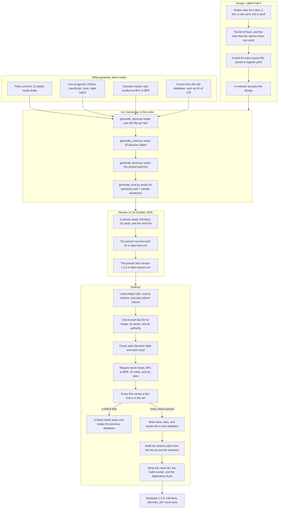

# How this Context Lake was created

| Field | Value |
|---|---|
| Stage | This note records how version 1.0.0 of the Context Lake was built. |
| Date / version | 2026-10-25, v1.0 |
| Author / agent | Cursor Grok 4.7 |
| Status | This note describes the build that produced version 1.0.0. |
| Evidence sources | `context-lake/harvest/run_harvest.py`; `context-lake/build.py`; `context-lake/review/lake-review.md`; `context-lake/review/lake-version.md`; `context-lake/generated/manifest.json` |
| Assumptions | The counts are the 1.0.0 build: 148 facts, 180 links, 267 word rows. The review date is 18 October 2026. |
| Unresolved issues | The review file lists the reviewer for model-drafted items as Unknown. Decision FD-22 is the open item that will name that reviewer. |
| Residual risks | The harvest and `build.py` write a new copy when a person runs them. Reading this note leaves the files unchanged. |

A person ran this path on 18 October 2026. The result was Context Lake version 1.0.0. The harvest program writes one text file for each fact, plus the decision tables, the word list, and the tests. `build.py` reads those files, checks them, and writes one database. Application A and Application B open that database and read the facts. The harvest records counts from the old factory database. One count is 91 of 125. The lot rows stay in that old database. The old database updates those rows each shift.

The result file is [context-lake/generated/context-lake.sqlite3](../../context-lake/generated/context-lake.sqlite3). The build writes one database with three grids: facts, links, and words. The 25 rule cards stay as their own text files beside that database. Each card is a decision table. The build opens each text file and checks the table. Application B opens that same text file when it applies the rule. The database line is the sentence a person reads.

## Reading of each step

Each step says what the person or the program does. The next sentences say why the lake includes that piece.

### Design, called Half A

This step happens before any lake file is written. The project plan calls this step Half A. Half A is the written design.

People write the shape rules first. A fact has a name, a kind, a sentence, an owner, and a list of links. A rule card has a decision table and tests. A word has one definition and the other names that systems use for it. Every fact uses that same shape. The checklist accepts a file that has an owner and a target for every link. The lake uses one shape so a reader can find the owner and the links in the same place on every fact.

Next they write the list of facts the lake must hold. The harvest program reads that list and copies those facts. The list tells the harvest which notes to copy.

Then they write a matching note for words. Dispatch uses one name for the recipe field. The tool record uses another name. The note says those two names mean the same word. A search for either name finds that word.

Then they store a hash for each source file the lake will point at. A hash is a long code computed from the bytes in the file. The file `sources/register.yaml` stores that code next to the file name. The sentence "APAC 2026 is 25,000 USD" points at the archive file whose hash was stored. A later edit to that archive file produces a different hash. The build compares the stored code with the code of the file on disk.

A reviewer reads this design and accepts it. The harvest starts after that acceptance. A mistake in the shape rules is caught in this review, before the harvest copies it into every fact file.

### What the item writer reads

The item writer copies facts from files that already exist. It reads four groups of files.

The policy archive is a JSON file of recipe-release limits. JSON is a text file of labeled values. The archive has 15 rows. Each row is one year, one region, a start date, an end date, and a dollar limit. APAC in 2026 is 25,000 USD from 1 January through 31 December. The lake stores a reviewed sentence about that row. The number itself remains in the archive. A reader points at the lake sentence, and the sentence points at the archive row.

The four old programs are a Python file, a JavaScript file, a Java file, and a night-batch file. The writer records what each program does. The program file stays in its own folder and still runs the factory work. One recorded behavior is in the JavaScript file: it allows 5 percent over the archive limit. A later reader points at that description.

The decision tracker is a written list of decisions that were already locked. Each lake fact names the decision and the person who locked it. A later reader reads that fact.

The conflict list is items BP1 through BP8. Each item is a fact with an owner. BP1 says 91 of 125 process steps have two different recipe values.

The counts come from the old database. The writer records the number, such as 91 of 125. The lot rows that produced the number stay in the old database. That database updates those rows each shift. The reviewed sentence keeps the number from the build. A later change to the sentence starts when a person edits the source and runs the build again.

### Harvest

A person runs one program, `run_harvest.py`. It calls four writers, in this order. The four writers do four jobs: a sentence, a decision table, a word list, and a test.

The first writer makes one text file per fact. The file type is YAML. YAML is a text file with one label on each line. The finished set has 148 files. One file is marked draft. A reviewer marks a file accepted before readers use it. Each fact has one owner, one sentence, and one review. A reader points at that file by its id.

The second writer makes 25 rule cards. A rule card is the decision table for one rule. The table says which inputs to read and what result to give. These 25 files remain text files. The database step writes the facts, the links, and the words. Application B reads the text file to apply the rule. The same inputs then give the same result. When the text file is missing, the result names that missing card.

The third writer makes the word list. One word can have several local names. The build turns those local names into 267 rows. Two teams keep their own names. Both names share one meaning. A search on either name finds the same word.

The fourth writer makes the tests. There are 26 questions. There are also 7 sample sentences. A sample sentence may contain the words "approve the lot". The test treats that sentence as text. A person still makes the lot decision. After a rebuild, the same question must find the same fact.

### Review round

A person reads the harvest output: 148 facts, 25 rule cards, and the word list. The reading happened on 18 October 2026. This was one review round. The earlier checks test the shape of each file. The person checks whether the sentence is the meaning the factory should rely on.

The person writes each mistake, the text before the fix, and the text after the fix. Those notes are in `lake-fixes.md`. The fixes are applied to the text files. A later reader can see the old text and the replacement.

The person sets the lake version to 1.0.0. A later change runs this review again. Adding a fact with the same meaning makes the version 1.0.1. Changing what an existing fact means makes the version 1.1.0 and needs a written decision. Removing an accepted fact makes the version 2.0.0. The version number tells two readers whether they are looking at the same set.

The review file lists the reviewer for model-drafted items as Unknown. Decision FD-22 is the open item that will name that reviewer.

### Build

A person runs `build.py`. This program writes the lake database. Application A and Application B open that database and read it.

The program loads three lists. The first list is the shape rules. The second list is the hash of each source file. The third list is the real table names and column names from the old database. A fact names a column from that third list. A fact names a source file whose stored hash still matches the file.

The program checks each fact. The file name matches the fact id. A business rule names the person or role allowed to set that rule. A trusted sentence states a fact. The check rejects a trusted sentence that tells the reader to approve a lot. The check rejects a sentence that contains a lot id such as L00000016. That lot row stays in the factory database. An accepted fact sits in the accepted folder. A file that is still in the drafts folder fails the check. Each accepted sentence has an owner. The reader sees that owner on the fact.

The program checks each of the 25 decision tables and each word. When a rule has no named authority yet, the table sends the case to a person. In the old JavaScript file, 999,999 means the year or the region is missing. A decided limit in the lake is a real dollar amount, such as 25,000 USD for APAC in 2026. The check rejects 999,999 as a decided limit.

The program checks the whole set. The seven kinds are a business rule, a domain word, an architecture note, a code behavior, a data relationship, a dependency, and a recorded decision. Each kind has at least one accepted fact. Decisions BP1 through BP8 are present. All 25 rule cards are present. Each of the six factory sites is present both as a fact and as a word. A missing decision or a missing site stops the build.

The program checks every link. Every link names a fact id that is in the set. A link whose target id is missing stops the build. The links that pass become the knowledge graph. A knowledge graph is the set of links from one fact to another.

When a check fails, the program stops. The previous database file stays in place. The applications keep reading that previous file. The program writes the new database only after every check passes.

When every check passes, the program deletes the old database and writes a new one. The new file has three tables. One table holds the facts. One table holds the links. One table holds the words, with one row for each local name. Every reader opens this one complete file.

The program then builds a search index on the fact id and the sentence. The build passes when that index contains the facts. An empty index fails the build. A question uses the index to find a sentence.

Last, the program writes three receipts. `enums.generated.json` lists the allowed names, including every fact id. `manifest.json` records the version, the time, the counts, and the database hash. `app-b-pin.json` is the pin for Application B. The pin is the SHA-256 code of the database file. SHA-256 is a long code computed from the whole file. Application B starts when the database on disk has that same code.

### Finished file

The database file is `context-lake.sqlite3`, version 1.0.0. It holds 148 facts, 180 links, and 267 word rows. The 25 rule cards remain separate text files. Application B reads a card's decision table when it applies that rule. The database holds the reviewed sentence a reader points at. Application A and Application B open this database and read it. A lot moving through the factory updates the factory database. The lake sentences stay as they were at this build. A change to a lake sentence starts in the source text files. A person then runs the harvest, the review, and the build again.
