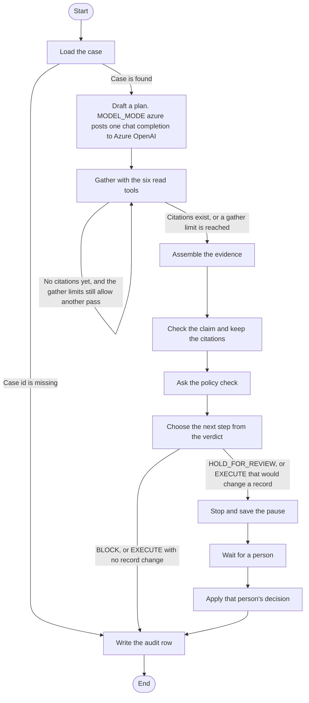
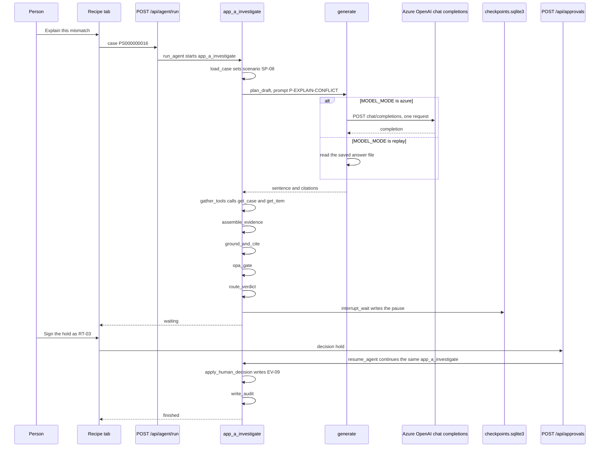
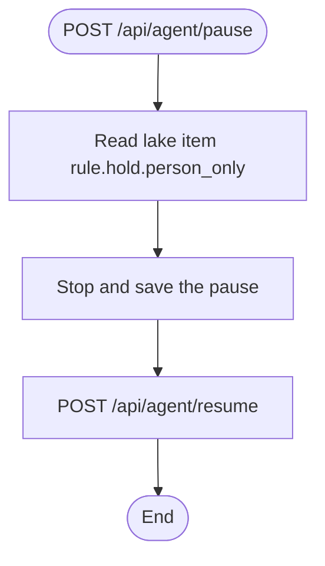

# LangGraph architecture

This note describes the two LangGraph graphs that run in Force Fab. LangGraph is the Python library that runs a fixed list of steps and can pause one step until a person sends a decision. The pause is written to a SQLite file. A restart of the app can read that file and continue the same case.

The packages pinned in `requirements-platform.txt` are `langgraph==1.0.3`, `langgraph-checkpoint==3.0.1`, and `langgraph-checkpoint-sqlite==3.0.1`.

## Where the graphs run

| App | Graph name in code | File | What a person does | Checkpoint file |
|---|---|---|---|---|
| Application A, port 8100 | `app_a_investigate` | `apps/app_a/agent/graph.py` | Scenarios, Recipe tab, **Explain this mismatch**. Later, **Sign the hold** or a signature on Approvals. | `apps/app_a/runtime/checkpoints.sqlite3` |
| Application B, port 8110 | pause graph, no display name | `apps/app_b/agent/pause.py` | No menu button. A caller posts `POST /api/agent/pause`, then `POST /api/agent/resume`. | `apps/app_b/runtime/checkpoints.sqlite3` |

Application A is the investigation. One agent does that work. Its name is `app_a_investigate`. **Explain this mismatch** starts it through `run_agent()`. The model runs once, inside draft a plan, through `generate()` with prompt `P-EXPLAIN-CONFLICT`. When `MODEL_MODE` is `azure`, that call posts one chat completion to Azure OpenAI. When `MODEL_MODE` is `replay`, that call reads a saved answer file. **Sign the hold** continues the same agent through `resume_agent()`. That resume keeps the draft from the first model call. The agent loads a case, drafts a plan, reads the lake, checks the claim, asks the policy check, and then either writes the audit row or waits for a person.

Application B is the short pause. It reads one lake item, then waits for a different person. It does not draft a plan and it does not call the six read tools.

`APP_A_CHECKPOINT_PATH` replaces the Application A file path when that environment variable is set. `APP_B_CHECKPOINT_PATH` does the same for Application B.

## Application A pieces

| Piece | File | What it does |
|---|---|---|
| Graph | `apps/app_a/agent/graph.py` | Builds agent `app_a_investigate`. `run_agent()` starts it. `resume_agent()` continues it. |
| Steps | `apps/app_a/agent/nodes.py` | Each function is one step. `plan_draft` calls `generate()`. `interrupt()` is inside `interrupt_wait`. |
| Azure OpenAI | `apps/app_a/intelligence/azure_client.py` | `complete_azure()` posts one chat completion when `generate()` runs with `MODEL_MODE` set to `azure`. |
| Checkpoint | `apps/app_a/agent/checkpointer.py` | Opens the SQLite file with `SqliteSaver`. |
| Waiting list | `apps/app_a/agent/waiting.py` | Reads the checkpoint so Approvals can find a paused correlation id. |
| Step limits | `apps/app_a/agent/budget.py` | Sets the recursion limit to 12, the step budget to 8, tool calls to 8, and gather visits to 3. |
| Read tools | `apps/app_a/agent/tools.py` | Six read names. The write list is empty. |
| Start route | `apps/app_a/routes/agent.py` | `POST /api/agent/run` calls `run_agent()`. |
| Resume route | `apps/app_a/routes/approvals.py` | `POST /api/approvals` calls `resume_agent()` when a checkpoint is still waiting. |
| Screen | `apps/ui_shared/src/DemoApp.jsx` | `investigate()` starts the run. `confirmHold()` posts the hold. |

The six read tools are `search_items`, `get_item`, `get_links`, `rule_at`, `get_case`, and `get_recovery_status`. The model cannot call a write tool from this list.

Each run uses one correlation id as the LangGraph `thread_id`. A second `POST /api/agent/run` mints a new correlation id unless the caller sends the old id in the header.

## Application A diagram

The pause box is the LangGraph `interrupt()` call. `SqliteSaver` writes the thread to `apps/app_a/runtime/checkpoints.sqlite3` before the HTTP call returns. The next node runs when `resume_agent()` sends `Command(resume=...)` with the same correlation id. That call continues agent `app_a_investigate`. The Azure OpenAI POST stays the one in draft a plan.

`plan_draft` calls `generate()` in `apps/app_a/intelligence/generate.py`. `generate()` retrieves lake items for the prompt, then chooses the answer source from `MODEL_MODE`:

| `MODEL_MODE` | What `generate()` does for this Recipe case |
|---|---|
| `azure` | `complete_azure()` sends one HTTP POST to `{AZURE_OPENAI_ENDPOINT}/openai/deployments/{AZURE_OPENAI_DEPLOYMENT}/chat/completions?api-version={AZURE_OPENAI_API_VERSION}`. The body is one user message, the canonical prompt. The header carries the API key. |
| `replay` | `generate()` reads a saved answer file. No HTTP call goes to Azure OpenAI. |

The POST runs when retrieval returned lake items and the call is still inside the budget. The four settings `AZURE_OPENAI_ENDPOINT`, `AZURE_OPENAI_API_KEY`, `AZURE_OPENAI_DEPLOYMENT`, and `AZURE_OPENAI_API_VERSION` must be present. When one of them is empty, `complete_azure()` returns `missing_model_config` and the POST is not sent. When retrieval returns no items and the run is not blocked, `generate()` returns a lake statement and skips the POST.

`gather_tools` may run again only when all of these are true: the citation list is empty, the run is not blocked, the budget flag is clear, gather visits are under 3, tool calls are under 8, and steps are under 8. The first pass that finds a citation, or that hits one of those limits, goes on to assemble the evidence.

The whole graph also stops if LangGraph counts more than 12 step transitions. That limit is `recursion_limit` in `apps/app_a/agent/budget.py`. On that stop, `run_agent()` writes audit event EV-07 with step name `recursion_limit` and returns `error_class` `wait_for_person`. That return does not leave the graph sitting inside `interrupt()`.

## How a person starts and resumes Application A

Worked example. Lot `L00000016` on tool `T0000013` has dispatch recipe `R02` and tool recipe `R01`. The case id is `PS000000016`.

1. Open **Scenarios**.
2. Open the **Recipe** tab.
3. Choose **Explain this mismatch**. The screen function `investigate()` posts `/api/agent/run` with `case_id` `PS000000016` and `proposed_action` `review recipe mismatch`. `run_agent()` starts agent `app_a_investigate`.
4. The agent loads the case and sets the scenario to `SP-08`. It calls the model once in `plan_draft`, through `generate()` with prompt `P-EXPLAIN-CONFLICT`. When `MODEL_MODE` is `azure`, `complete_azure()` posts one chat completion to Azure OpenAI. When `MODEL_MODE` is `replay`, `generate()` reads a saved answer file. The agent then reads the lake, checks the claim, and asks the policy check. For this Recipe case it stops at `interrupt()` when the verdict waits for a person.
5. On the same Recipe tab, a person with role RT-03 Process Engineer chooses **Hold**, types a reason, and chooses **Sign the hold**. `confirmHold()` posts `/api/approvals` with action `recipe_hold_or_release` and decision `hold`. The signer must be a different person from the draft author.
6. If the checkpoint for that correlation id is still waiting, `apps/app_a/routes/approvals.py` calls `resume_agent()`. That continues the same agent `app_a_investigate` at `apply_human_decision`. The Azure OpenAI POST stays the one from step 4. The agent writes the audit row and ends.

The **Approvals** menu can resume the same waiting thread. Its sign action also posts `/api/approvals`. Resume happens when that post matches a saved pause for the case.

**Try to approve from the feed note**, on the same Scenarios page, also posts `/api/agent/run`. The body is case `REPLAY-000000000`, scenario `IC-01`, and `proposed_action` `approve`. That post starts a new run of agent `app_a_investigate`. `plan_draft` calls `generate()` once with prompt `P-DRAFT-PLAN`. When `MODEL_MODE` is `azure`, that call is the same Azure OpenAI chat completion POST. The policy check returns BLOCK for that feed note, so the agent writes the audit row and ends. It does not open the Recipe hold.

## Event sequence for the Recipe mismatch

The audit chain stores one row per step. The event codes below are the codes the nodes write today. The column "Investigation phrase" uses the words from this sentence: Application A loads a case, drafts a plan, reads the lake, checks the claim, asks the policy check, and then either writes the audit row or waits for a person. Rows 2, 3, 4, 6, 7, 8, 9, and 13 repeat a phrase from that sentence. The other rows say where they sit next to those phrases. The column "Agent" names `app_a_investigate` on every row where that agent is running. Row 3 names the one Azure OpenAI POST.

| Order | Investigation phrase | Step | Agent | What happens | Audit event |
|---|---|---|---|---|---|
| 1 | The button starts the run. This is before "load a case". | Screen | `run_agent()` starts `app_a_investigate`. | **Explain this mismatch** posts `/api/agent/run`. | none yet |
| 2 | load a case | `load_case` | `app_a_investigate` sets scenario `SP-08`. | The case `PS000000016` is read. | EV-08, step `load_case` |
| 3 | draft a plan | `plan_draft` | `app_a_investigate` calls `generate()` once. The prompt id is `P-EXPLAIN-CONFLICT`. When `MODEL_MODE` is `azure`, `complete_azure()` posts one chat completion to Azure OpenAI. When `MODEL_MODE` is `replay`, `generate()` reads a saved answer file. | The draft sentence is written into the graph state. | EV-08, step `plan_draft` |
| 4 | reads the lake | `gather_tools` | `app_a_investigate` calls `get_case` and `get_item` in code. | One or more of the six read tools run. The step repeats while the citation list is empty and the limits above still allow it. | EV-08, step `gather_tools`, once per pass |
| 5 | The tool results are collected. This sits between "reads the lake" and "checks the claim". | `assemble_evidence` | `app_a_investigate` continues. The Azure OpenAI POST remains the one in row 3. | The tool results are collected into the evidence for this case. | EV-08, step `assemble_evidence` |
| 6 | checks the claim | `ground_and_cite` | `app_a_investigate` runs `ground()` in code. | The draft is checked against the citations. A claim without a citation is not treated as grounded. | EV-08, step `ground_and_cite` |
| 7 | asks the policy check | `opa_gate` | `app_a_investigate` calls the policy check in code. | The policy check returns EXECUTE, HOLD_FOR_REVIEW, or BLOCK. | EV-07, step `opa_gate` |
| 8 | waits for a person | `route_verdict` | `app_a_investigate` selects the pause. | HOLD_FOR_REVIEW, or EXECUTE that would change a record, selects the pause. | EV-08, step `interrupt_wait`, notes `paused` |
| 9 | waits for a person | `interrupt_wait` | `app_a_investigate` pauses. The Azure OpenAI POST remains the one in row 3. | `interrupt()` stops the graph. The saved payload is the case id, the proposed action, the waiting role, the draft plan, the citations, and the correlation id. `SqliteSaver` writes `apps/app_a/runtime/checkpoints.sqlite3`. The HTTP response tells the screen the run is waiting. | The pause row was written in the previous step |
| 10 | The person signs. This is after "waits for a person". | Screen | The person signs. `app_a_investigate` stays paused until row 11. | RT-03 chooses **Sign the hold**. The screen posts `/api/approvals`. | none yet |
| 11 | The graph resumes. This is after "waits for a person". | `interrupt_wait` resumes | `resume_agent()` continues the same `app_a_investigate`. The Azure OpenAI POST remains the one in row 3. | `Command(resume=...)` returns the decision, the action type, and the signer into the graph. | EV-08, step `interrupt_wait`, notes `resumed` |
| 12 | The hold is stored. This is after "waits for a person" and before "writes the audit row". | `apply_human_decision` | `app_a_investigate` stores the hold. | The hold is stored. For this button the action type is `recipe_hold_or_release`, so the human event is EV-09. An owner assignment would write EV-10 instead. | EV-09, step `apply_human_decision` |
| 13 | writes the audit row | `write_audit` | `app_a_investigate` writes the closing row. | The closing control row is written. | EV-08, step `write_audit` |
| 14 | The run ends. This is after "writes the audit row". | End | `app_a_investigate` ends. | The graph finishes. The Recipe audit band lists the rows for that correlation id. | none |

EV-07 means the policy verdict was recorded. EV-08 means one graph step was recorded. EV-09 means a person recorded a decision such as hold. EV-10 means a person assigned an owner. EV-12 means the policy check blocked the run.

## Other endings on the same graph

| Condition | Next step | Audit event | Pause file |
|---|---|---|---|
| `load_case` sets `error_class` to `not_found` | `write_audit`, then end | EV-08 from `write_audit` | no pause |
| Policy verdict BLOCK | `route_verdict` then `write_audit` | EV-12 at `route_verdict`, then EV-08 at `write_audit` | no pause |
| Policy verdict EXECUTE and `record_change` is false | `write_audit`, then end | EV-07 at the policy step, then EV-08 at `write_audit` | no pause |
| Policy verdict HOLD_FOR_REVIEW | `interrupt_wait` | EV-08 with notes `paused` | row kept until resume |
| Policy verdict EXECUTE and `record_change` is true | `interrupt_wait` | EV-08 with notes `paused` | row kept until resume |
| More than 12 step transitions | `run_agent()` catches `GraphRecursionError` | EV-07, step `recursion_limit` | no interrupt left open |

The feed-note button starts a new `app_a_investigate` and is the BLOCK row. The Recipe **Explain this mismatch** button starts `app_a_investigate` for `PS000000016` and is the pause row when the policy check returns HOLD_FOR_REVIEW.

These endings stay inside agent `app_a_investigate`. The Azure OpenAI POST runs when the path reaches `plan_draft` and `MODEL_MODE` is `azure`. A missing case goes to `write_audit` before that call.

## Application B pause

Application B uses a second, shorter graph in `apps/app_b/agent/pause.py`. The code gives this graph no name. Recipe uses agent `app_a_investigate` on Application A. This Application B graph is a separate pause. No screen button calls it. The pause reads one lake item and waits. Application B's draft route reads a saved file or a lake sentence.

`start_pause()` in `apps/app_b/agent/pause.py` starts the graph. The default case id is `PS000000016`. The caller must send a correlation id. `interrupt()` saves `proposed_by` `model_draft`, verdict `HOLD_FOR_REVIEW`, and the correlation id. The file is `apps/app_b/runtime/checkpoints.sqlite3`.

`resume_pause()` refuses the call when the actor id is `model_draft`, the same id that proposed the pause. A different actor id sends `Command(resume=...)` and the graph ends.

`POST /api/agent/run` on Application B does not use this graph. That route drafts an answer in `apps/app_b/routes/agent.py` and returns. It does not compile a `StateGraph`.

## Screens that use other code

The knowledge-graph page draws lake links in the browser. That page reads stored edges. It does not call LangGraph.

The Ask boxes on Cases, Lots, and Faults call `/api/ask`. Those boxes do not start `app_a_investigate`.

Replay, Clocks, Policy, Outage, Rule trace, and Compare call the demo routes named on each button. Those buttons do not start `app_a_investigate`. Recipe is the scenario tab that does.
