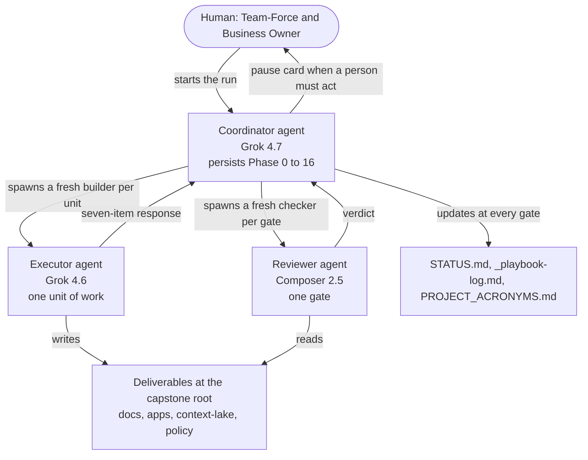
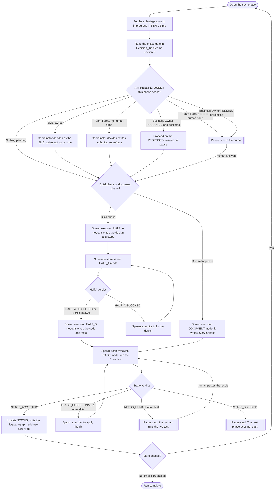
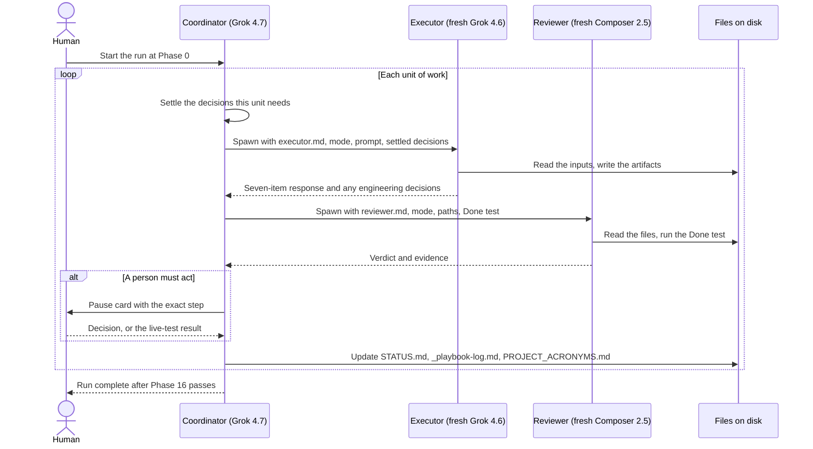

# Agentic execution architecture — Sprint 4 Fabpulse capstone

| Field | Value |
|---|---|
| Stage | Run mechanics. Describes how the playbook runs, not the solution the playbook builds. |
| Date / version | 2026-10-18, v1.2 |
| Author | Mangesh (FDE, Team-Force), drafted with Cursor |
| Status | Active. Matches `playbook/00_coordinator.md`, `playbook/executor.md`, and `playbook/reviewer.md`. |
| Evidence sources | `playbook/00_coordinator.md`, `playbook/executor.md`, `playbook/reviewer.md`, `playbook/README.md`, `Decision_Tracker.md`, `Execution_Plan.md` section 7. |
| Assumptions | The session that runs the coordinator can spawn a subagent and pick its model. |
| Unresolved issues | None. |
| Residual risks | If the runtime cannot spawn a subagent on the named model, the executor and reviewer steps cannot run as designed; see "Runtime assumption" below. |

## What this document is

This document shows how the project is built, step by step, by three software agents.

An agent here is one chat session with a language model, given a prompt and a set of files. The project uses three agents with three jobs.

- The coordinator runs the show. It settles decisions, spawns the other two, updates the trackers, and advances the run. It builds nothing itself.
- The executor builds the work.
- The reviewer checks the work.

They run on different models, so no agent grades its own output, and the builder is not the checker. The sections below name each agent, show the loop they run for every phase, and show where a person must step in.

This is the architecture of the run. It is not the architecture of the product. The product architecture (the two apps, the Context Lake, the OPA gate) is written later, in Phase 4, under `docs/10-architecture/`.

## The three agents

| Agent | Model | Lives for | Job |
|---|---|---|---|
| Coordinator | Grok 4.7 (`grok-4.7-high-fast`) | The whole run, Phase 0 to Phase 16 | Reads the plan, settles the decisions it owns, spawns the executor to build each unit, spawns the reviewer to check it, applies fixes, updates the trackers, and advances the run. It writes no phase artifact itself. |
| Executor | Grok 4.6 (`cursor-grok-4.6-high-fast`) | One unit of work only | A fresh agent the coordinator spawns to build one unit. It reads the inputs on disk, writes the artifacts, and returns the seven-item response. |
| Reviewer | Composer 2.5 (`composer-2.5-fast`) | One gate only | A fresh agent the coordinator spawns at each gate. It reads the files on disk, checks them against the Expected output, runs the Done test, and returns a verdict. |

"Spawn" means the coordinator starts a new agent with the Task tool, with `subagent_type: generalPurpose` and the agent's model. For the executor it passes `playbook/executor.md`, the mode, the prompt, the input paths, the settled decisions, and the output folders. For the reviewer it passes `playbook/reviewer.md`, the mode, the file paths, the Expected output, the Done test, the Locked facts, and the relevant `Decision_Tracker.md` rows.

Each executor and each reviewer is a new agent. The coordinator never reuses an earlier one, and the agent that built a unit never checks it. Over the whole run the coordinator spawns many executors and many reviewers.

## One unit of work

A unit is the smallest piece that gets its own gate. One executor builds it; one reviewer checks it.

- A document phase (0, 1, 2, 3, 4, 6, 14, 15, 16) is one unit. The executor runs in `DOCUMENT` mode; the reviewer runs once in `STAGE` mode.
- A build phase (5, 7, 8, 9, 10, 11, 12, 13) is two units: Half A, then Half B. The executor runs in `HALF_A` mode and the reviewer checks it; after acceptance a second executor runs in `HALF_B` mode and the reviewer checks again in `STAGE` mode.
- A hardening sub-stage in Phase 12 or 13 is two units of its own, so it gets its own executor pair and reviewer pair.

So a document phase spawns one executor and one reviewer. A build phase spawns at least two of each. The executor boundary and the reviewer boundary are the same boundary.

## The roles and the spawn relationship

## The per-phase loop

This is the loop the coordinator runs for every phase, from `playbook/00_coordinator.md`.

## The coordinator, executor, and reviewer over one unit

## The verdicts the reviewer returns

| Mode | Verdict | What the coordinator does |
|---|---|---|
| HALF_A | `HALF_A_ACCEPTED` | Start Half B. |
| HALF_A | `HALF_A_CONDITIONAL` | Apply the named fixes, then start Half B. |
| HALF_A | `HALF_A_BLOCKED` | Fix the design and re-review, or pause if it cannot be resolved. |
| STAGE | `STAGE_ACCEPTED` | Update the trackers, write the log, advance to the next phase. |
| STAGE | `STAGE_CONDITIONAL` | Apply a named fix and re-review, or pause if the Done test needs a person. |
| STAGE | `STAGE_BLOCKED` | Pause. The next phase does not start. |
| STAGE | `NEEDS_HUMAN` | The Done test needs a credential, a running service, or a network call. Pause so the human runs it. |

## Who owns the decisions

The three agents split decision work so the executor can stay a pure builder.

- The coordinator settles the policy and industry-fact decisions before it spawns the executor. These are the SME rows and the Business Owner rows in `Decision_Tracker.md`. It writes the answer into the tracker and passes it to the executor as a locked fact.
- The executor may make an engineering design decision that the build itself requires and that no one can settle before the design exists, for example the lake item schema. It records each one with evidence, marks it `authority: team-force`, and returns it. The coordinator logs it; the reviewer checks it at the gate.
- Neither the executor nor the reviewer sets a Business Owner or SME policy value. If the executor reaches a policy value that is not in its locked facts, it leaves the case to route to HOLD_FOR_REVIEW and raises an open question for the coordinator.

## Where a person steps in

The coordinator pauses and prints a pause card when any of these is true.

- A decision the phase needs is PENDING and owned by Team-Force with a human hand, or by the Business Owner and not accepted in the section 5.2 review sheet.
- The phase needs a secret, a network call, a deploy, or a write outside the workspace.
- The reviewer returns `STAGE_BLOCKED`, or a `HALF_A_BLOCKED` the coordinator cannot resolve.
- The reviewer marks a Done test `NEEDS_HUMAN`.

From Phase 8 on, a Done test that needs a live model, a running stack, or a network call runs as a manual human step. The human provides the OpenAI API key whenever a test needs it. There is no offline replay fallback, by the team's choice.

## What the coordinator writes at each gate

| File | When | What goes in |
|---|---|---|
| `playbook/STATUS.md` | Phase start, Half A accepted, stage accepted, pause or block | The progress board, one row per sub-stage. |
| `docs/_playbook-log.md` | Stage accepted | One prose paragraph per completed phase. |
| `PROJECT_ACRONYMS.md` | Stage accepted | A row for each new short code the phase introduced. |

## Runtime assumption

This design needs the running session to spawn a subagent and choose its model. If the runtime cannot spawn a subagent on `cursor-grok-4.6-high-fast` or `composer-2.5-fast`, the executor or the reviewer cannot run as a separate agent. In that case that step must be run as a separate chat on the named model by hand, using `playbook/executor.md` or `playbook/reviewer.md`, so the builder and the checker stay independent of each other.

## Change log

| Version | Date | Change |
|---|---|---|
| v1.0 | 2026-10-18 | First issue. Documented the two-agent run: the persistent coordinator, the fresh reviewer spawned per gate, the per-phase loop, the decision gate, the verdicts, the human pause points, and the tracker updates. |
| v1.1 | 2026-10-18 | Added the executor agent. The coordinator now orchestrates only and spawns a fresh executor on `claude-sonnet-5-5-high` to build each unit; the reviewer is unchanged. Updated the agent table, all three diagrams, and added the "Who owns the decisions" section. |
| v1.2 | 2026-10-18 | Changed the three models. The coordinator runs on Grok 4.7 (`grok-4.7-high-fast`). The executor runs on Grok 4.6 (`cursor-grok-4.6-high-fast`). The reviewer runs on Composer 2.5 (`composer-2.5-fast`). |
